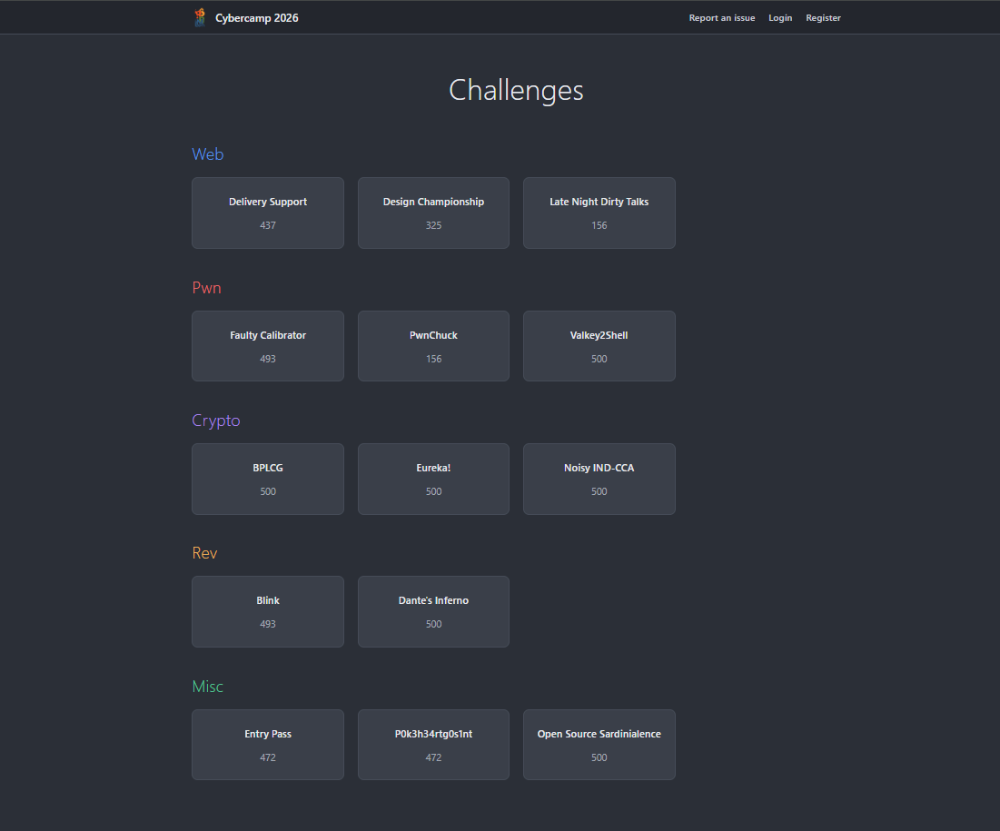
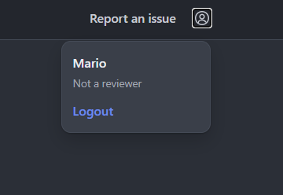
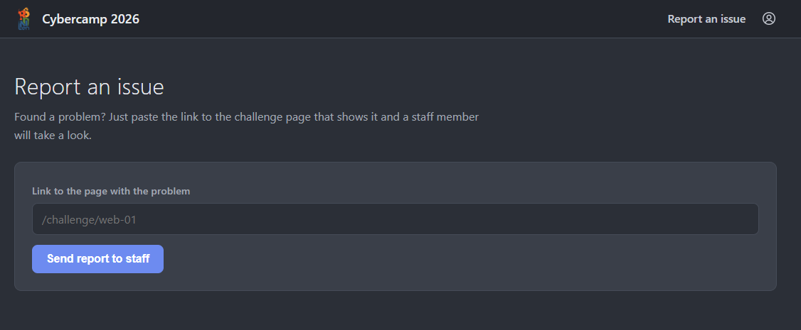
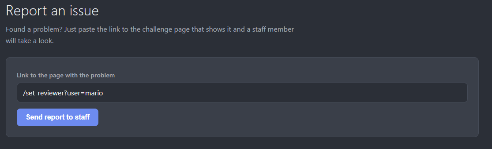
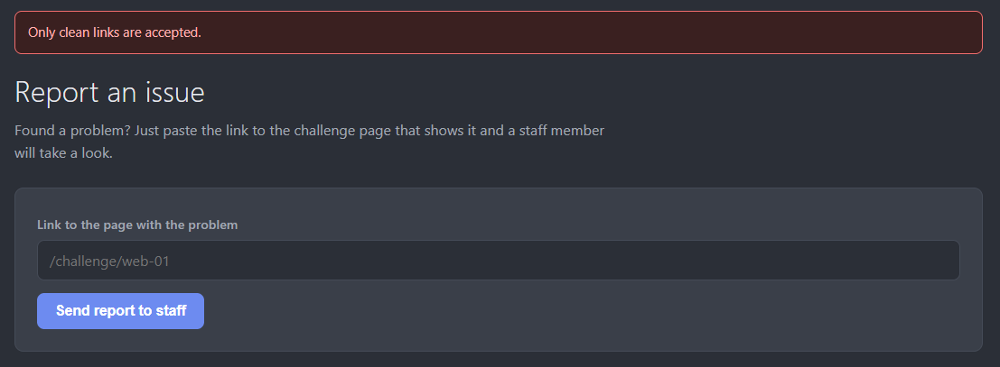
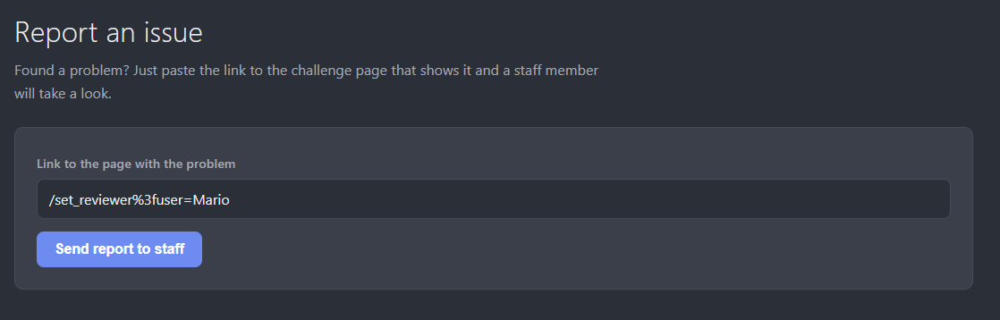
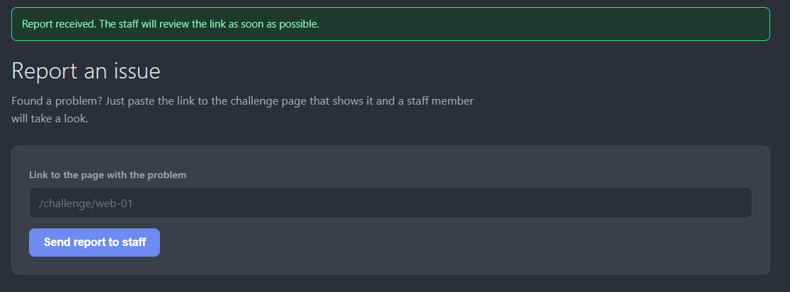
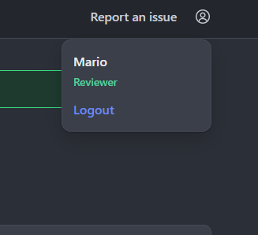
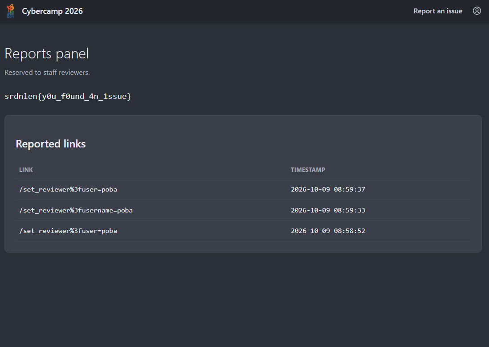
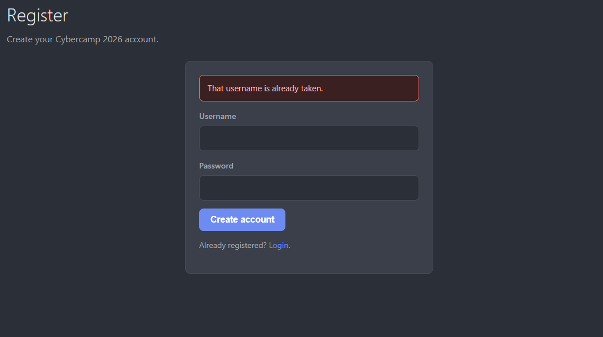

writeup for the challenge **"Any Issues?"** I made for the `Cybercamp 2026` speedrun, category **web**, difficulty: **easy**

### Introduction

> Spotted a broken challenge on the Cybercamp 2026 platform? Report the link and a staff reviewer will take a look as soon as possible.



The idea was simple: a fake CTF platform with a "Report an issue" feature.  
You submit a link, a *staff reviewer* bot adds it to the list of links and the admin checks it. No XSS, no exotic headers, the whole challenge rides on a **CSRF over a GET request** plus a small **parser differential**.  
I wanted to build something nice for a speedrun, slightly different from the usual vulns.

### overview

It's a whitebox challenge, so we get the source.  
A simple **Flask** web app (`src/backend/app.py`) with a separate **staff bot** (`src/bot/bot.py`).  
The **flag** is on `/reviews`, a page reserved to *reviewers*.

```python
# src/backend/app.py:178
@app.route("/reviews")
@login_required
def reviews():
    with lock:
        unlocked = g.username in reviewers
        items = list(reversed(reports)) if unlocked else []
    return render_template("reviews.html", unlocked=unlocked, flag=FLAG if unlocked else None, ...)
```

We register and... we're not a reviewer. The profile menu says so plainly.



So we immediately get that the goal is to **become a reviewer**.  
But how?

```python
# src/backend/app.py:166
@app.route("/set_reviewer", methods=["POST", "GET"])
def set_reviewer():
    if session.get("username") == ADMIN_USERNAME:
        user = request.values.get("user")
        if user:
            with lock:
                reviewers.add(user)
    return redirect("/reviews")
```

Only whoever is logged in as `admin` can promote someone. We're not admin.  
But we notice, from the fact that the bot logs in with the admin credentials, that it is.  

And we can make it fire a request at any link of our choosing using the **Report an issue** feature.



Already here we can spot a detail worth keeping in mind: the form placeholder is `/challenge/web-01`, i.e. a **relative path**.  
It's a hint about *how* to send the link to the bot, we'll come back to it.

### the vulnerability: CSRF over GET

Two details, important ones.

**1) `/set_reviewer` changes state and is reachable via GET.**  
Promoting a user is a *state-changing* action, but the route also accepts `GET` and reads `user` with `request.values.get(...)` (so it reads the query string too). (we couldn't get the bot to send a POST, only a real admin could)

**2) CSRF protection doesn't cover GET.**  
The app uses `CSRFProtect(app)` (`src/backend/app.py:16`), but by default Flask-WTF only validates the token for "unsafe" methods: `WTF_CSRF_METHODS = {"POST", "PUT", "PATCH", "DELETE"}`.  
`GET/HEAD/OPTIONS` are considered *safe* [by HTTP convention](https://developer.mozilla.org/en-US/docs/Glossary/Safe/HTTP) and are **never checked**.  
Here, though, the GET request *does* have a side effect, so CSRF protection is effectively absent on that route.

> This is a classic [CSRF](https://owasp.org/www-community/attacks/csrf) don't expose state-changing actions over GET, and don't rely on the framework "having CSRF protection enabled", which here, by default, [doesn't look at safe methods](https://flask-wtf.readthedocs.io/en/1.2.x/csrf/).

So, we only need the admin to open `/set_reviewer?user=<our_user>`. Enter the bot.

### "why call it a bot if it's just `requests`?"

Someone during the event pointed out that the bot, not being a headless one (it's just `requests` calls), couldn't really be called one.  
Worth clarifying that in CTF land **"admin bot" means an automated privileged visitor**, not necessarily a headless Chrome.  
No browser was needed here: there's no XSS and no JavaScript to run, the vuln is a **pure server-side side effect on a GET**.  
A headless browser would have just been a complication; a `requests.Session` logged in as admin was enough.

```python
# src/bot/bot.py:25
session = requests.Session()
session.headers["User-Agent"] = "SrdnlenStaffBot/1.0"
...
def login():            # src/bot/bot.py:31 log in as staff on startup
    ...
    resp = session.post(f"{APP_BASE_URL}/login", data=data, ...)
    _logged_in = resp.is_redirect

def visit(target):      # src/bot/bot.py:58 opens the link via GET
    if not _logged_in:
        login()
    session.get(target, timeout=TIMEOUT, allow_redirects=False)
```

The bot is logged in as `admin` and opens every link coming from `/report`. If we make it open `/set_reviewer?user=...`, it, admin, promotes us.

### the filter and its bypass (parser differential)

It's not that immediate, though.  
The `/report` form **rejects any URL containing `?`**:

```python
# src/backend/app.py:149
if "?" in url:
    flash("Only clean links are accepted.", "err")
    return redirect("/report")
```




Without a `?` we can't pass `user=...` in the query string.  
But from the bot's code we notice that, **before** parsing the link, it normalizes it with `unquote()`:

```python
# src/bot/bot.py:45
def build_target(url):
    parsed = urlparse(unquote((url or "").strip()))   # <-- unquote() BEFORE parsing
    ...
    query = f"?{parsed.query}" if parsed.query else ""
    return f"{APP_BASE_URL}{parsed.path or '/'}{query}"
```

App and bot see two different strings, so it's a **parser differential** (validation and canonicalization happening in different places).  
We send the `?` encoded as `%3f` -> the app sees no `?` and accepts, the bot decodes it and rebuilds the query.




(note: to be fair, *anything* you submitted got this same "Report received", even a wrong link or one the bot dropped, more on this soon.)

### getting the flag

To recap:

1. **Register** and confirm you're not a reviewer (`/reviews` → *Access denied*).
2. In the `/report` form submit **the relative path** (this is the *intended* input, hinted by the placeholder `/challenge/web-01`, but it also worked with `localhost:1337`):

   ```
   /set_reviewer%3fuser=<your_user>
   ```

3. The bot, logged in as `admin`, normalizes `%3f` -> `?`, opens `/set_reviewer?user=<user>` via GET -> runs `reviewers.add("<user>")`.
4. Reload `/reviews`.




```
srdnlen{y0u_f0und_4n_1ssue}
```

### a small note on `ALLOWED_HOSTS`

I have to be honest here, because it caused some confusion during the event. On top of `unquote`, the bot validates the host against an allow-list:

```python
# src/bot/bot.py:51
if parsed.netloc and parsed.netloc not in ALLOWED_HOSTS:
    return None
```

The comparison was an **exact string match** on `netloc` (`host[:port]`).  
The thing is, it had to match **exactly**, as a string.  
Many players, understandably, did the most natural thing, i.e. copy the challenge URL from the browser and paste it as-is, something like `https://anyissues.challs.srdnlen.it/set_reviewer%3fuser=x`. The problem is that the smallest difference in the `netloc` (a port like `:443`, an instancer `IP:port`, and so on) was enough for it to no longer be in the list: the bot dropped the request with a `400` and opened nothing.

But I want to make clear that the `ALLOWED_HOSTS` were exactly the same locally and remotely; it was a problem I hadn't considered when I tested the challenge.

And I also apologize for one detail: **whatever you submitted, the app always answered *"Report received"***. This was intended, just to make you debug a bit more and lose a few minutes since it's a speedrun, but in hindsight I wouldn't do it. It never checked the bot's response, so there was **no error message** when the link got dropped. Anyone pasting the domain in good faith had no way to tell the request never reached its target, and the frustration is completely understandable. A plain "link rejected" would have solved half the grumbling, and it should have been there.

The *intended* path avoided all of this anyway: **the relative path**, `/set_reviewer%3fuser=...`, has no `netloc`, so it skips the allow-list and the bot rebuilds the request toward its internal `APP_BASE_URL`. Not by accident, the form placeholder was exactly `/challenge/web-01`: **a relative path, meant as the hint**.

Sending `http://localhost:1337/...` would have worked just the same: many people, though, fixated only on the first host in the list, the challenge domain.

so in a challenge this small, the infrastructure details weigh as much as the vuln. The relative path was the right hint, but between a rigid allow-list and mute feedback, anyone trying "the obvious thing" got punished without understanding why. Next time, fewer unintended frictions and more room for the vuln I wanted to bring out. :))

### small changes I could have made

Nothing critical for the intended solve, but to make the challenge more robust:

- **A different password per user.** You could register with trivial credentials (`a`/`a`) and land in someone else's account. Better to ask only for a username and **generate** a strong password server-side, shown once.

  

- **Real report feedback.** Have the alert reflect the bot's actual outcome (`queued`/`rejected`) instead of the fixed "Report received" that hid the drops.
- **Allow-list on `hostname`** (port-insensitive, lowercase) instead of the raw `netloc`.

---

I hope that, despite these small imperfections, you enjoyed the challenge and that it hit the right note for a speedrun.

See you soon 💜
